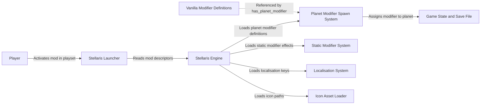
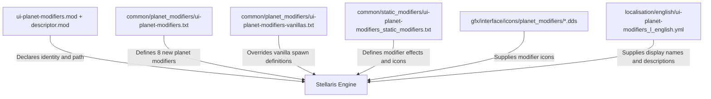
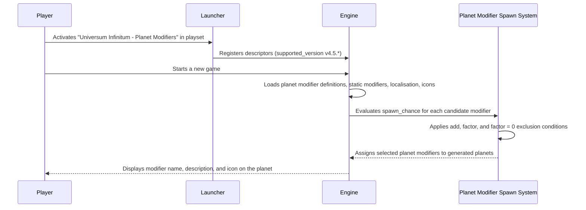
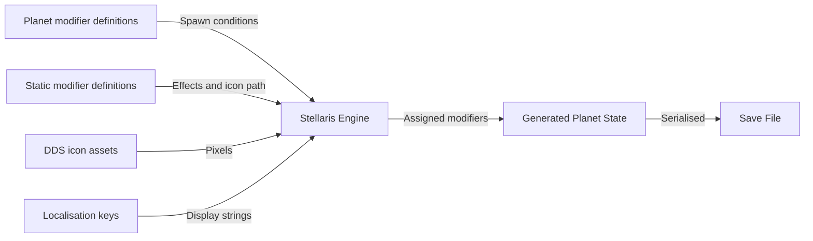
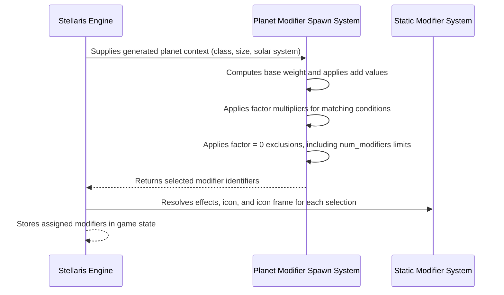
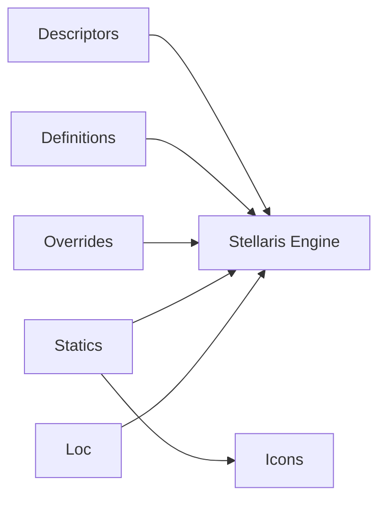

# Universum Infinitum: Planet Modifiers Architecture

This document describes the current architecture of the Stellaris mod "Universum Infinitum: Planet Modifiers". The mod is a declarative, data-driven extension that adds new planetary modifiers to the Stellaris planet-modifier system.

## 📑 Table of Contents

- [Purpose](#-purpose)
- [System Context](#-system-context)
- [Architectural Style](#-architectural-style)
- [Runtime Process](#-runtime-process)
- [Components](#-components)
- [Architectural Areas](#-architectural-areas)
  - [Mod Metadata](#mod-metadata)
  - [Planet Modifier Definitions](#planet-modifier-definitions)
  - [Static Modifier Definitions](#static-modifier-definitions)
  - [Icon Assets](#icon-assets)
  - [Localisation](#localisation)
- [Data Architecture](#-data-architecture)
- [Interfaces and Integrations](#-interfaces-and-integrations)
- [Key Processes](#-key-processes)
  - [Planet Modifier Selection During Galaxy Generation](#planet-modifier-selection-during-galaxy-generation)
- [Planet Modifier Spawn Weighting](#-planet-modifier-spawn-weighting)
- [Cross-Cutting Concerns](#-cross-cutting-concerns)
  - [Security and Privacy](#security-and-privacy)
  - [Error Handling](#error-handling)
  - [Observability](#observability)
  - [Configuration](#configuration)
- [Dependency Direction and Rules](#-dependency-direction-and-rules)
- [External Dependencies](#-external-dependencies)
- [Deployment and Operations](#-deployment-and-operations)
- [Compatibility Contracts](#-compatibility-contracts)
- [Testing and Verification](#-testing-and-verification)
- [Design Constraints](#-design-constraints)
- [Extension Points](#-extension-points)
  - [Adding a Planet Modifier](#adding-a-planet-modifier)
- [Source Map](#-source-map)
- [Related Documentation](#-related-documentation)

## 🎯 Purpose

The mod extends Stellaris planetary generation by contributing four new planet modifiers, each with a spawn-chance definition, a static modifier effect block, a DDS icon, and English localisation. It also overrides selected vanilla planet-modifier spawn definitions to exclude the newly added modifiers from conflicting combinations. The system boundary is the set of data files consumed by the Stellaris engine; the mod executes no code of its own. This document records those boundaries so that contributors can locate ownership, follow the selection process, and evaluate the impact of a change.

## 🌐 System Context

The principal external boundaries are:
- **Stellaris Launcher:** Reads `ui-planet-modifiers.mod` and `ui-planet-modifiers/descriptor.mod` to register the mod, its path, tags, and declared game version.
- **Stellaris Engine:** Parses `common/planet_modifiers/` and `common/static_modifiers/` definitions during game initialisation and galaxy generation.
- **Vanilla Modifier Definitions:** The mod references vanilla modifier identifiers such as `pm_tidal_locked`, `pm_low_gravity`, `pm_high_gravity`, `pm_bleak`, `pm_lush`, and `pm_titanic_life` in its spawn conditions without defining them.
- **Game State and Save File:** Assigned modifiers persist in the engine-owned save file; the mod owns no persistent state.

## 🏗️ Architectural Style

**Declarative, data-driven host extension (mod profile)** — The repository contains no executable code, build step, or scripting layer. Every artefact is a static definition file or an image asset consumed by the Stellaris engine, which owns all parsing, evaluation, and persistence.

The principal architecture boundaries are:
- **Mod Metadata:** Declares mod identity, filesystem path, tags, and declared game version; owns no behaviour.
- **Planet Modifier Definitions:** Owns spawn-chance conditions for the four new modifiers.
- **Vanilla Spawn Overrides:** Owns revised spawn-chance conditions for selected vanilla and mod-extended modifiers.
- **Static Modifier Definitions:** Owns modifier effects, icon path references, icon frames, and the `important` flag.
- **Localisation:** Owns English display names and descriptions keyed to the static modifier identifiers.
- **Icon Assets:** Own binary DDS icons referenced by static modifier definitions.

## 🔄 Runtime Process

The principal runtime sequence is:
1. The launcher registers both descriptors and exposes the mod for activation.
2. The engine loads the mod's definition, localisation, and image files during initialisation.
3. During planet generation the spawn system evaluates each `spawn_chance` block, applying `add` values, `factor` multipliers, and `factor = 0` exclusions.
4. The static modifier system applies the matched effect block and resolves its `icon` path and `icon_frame`.
5. The assigned modifier persists in the save file and is presented through the localised name and description.

## 🧩 Components

| Component | Responsibility | Principal Dependencies | Lifetime or Ownership |
|-----------|----------------|------------------------|-----------------------|
| `ui-planet-modifiers.mod` | Root mod descriptor: name, path, tags, declared game version | Stellaris launcher mod loader | Static file, owned by mod author |
| `ui-planet-modifiers/descriptor.mod` | Local mod descriptor with identical metadata | Stellaris launcher mod loader | Static file, owned by mod author |
| `ui-planet-modifiers/common/planet_modifiers/ui-planet-modifiers.txt` | Defines the four new `pm_ui_*` planet modifiers and their spawn chances | Stellaris planet modifier spawn system | Static file, owned by mod author |
| `ui-planet-modifiers/common/planet_modifiers/ui-planet-modifiers-vanillas.txt` | Overrides spawn chances for selected vanilla and mod-extended modifiers | Stellaris planet modifier spawn system | Static file, owned by mod author |
| `ui-planet-modifiers/common/static_modifiers/ui-planet-modifiers_static_modifiers.txt` | Defines effects, icons, icon frames, and importance for the new modifiers | Stellaris static modifier system; icon assets | Static file, owned by mod author |
| `ui-planet-modifiers/gfx/interface/icons/planet_modifiers/*.dds` | Supplies one DDS icon per new modifier | Stellaris icon asset loader | Static binary assets, owned by mod author |
| `ui-planet-modifiers/localisation/english/ui-planet-modifiers_l_english.yml` | Supplies English names and descriptions for the new modifiers | Stellaris localisation system | Static file, owned by mod author |
| `ui-planet-modifiers/thumbnail.png` | Supplies the mod thumbnail presented by the launcher | Stellaris launcher mod browser | Static binary asset, owned by mod author |
| `src/planet_modifier.xcf` | Retains editable source artwork for the icons | Image editor | Source asset, owned by mod author |

## 🗂️ Architectural Areas

### Mod Metadata

Paths:
- `ui-planet-modifiers.mod`
- `ui-planet-modifiers/descriptor.mod`

Responsibilities:
- Declare the mod name, path, tags, and declared supported game version.

Boundary rules:
- Both descriptors must remain identical in `name`, `path`, `tags`, and `supported_version`.
- `path` must point to the in-repository content directory `ui-planet-modifiers`.

### Planet Modifier Definitions

Paths:
- `ui-planet-modifiers/common/planet_modifiers/ui-planet-modifiers.txt`
- `ui-planet-modifiers/common/planet_modifiers/ui-planet-modifiers-vanillas.txt`

Responsibilities:
- Define spawn-chance conditions, `add` weights, `factor` multipliers, and `factor = 0` exclusions for each modifier identifier.
- Override selected vanilla spawn definitions so that the new modifiers can participate in the same selection pool.

Boundary rules:
- Each definition key must be a unique `pm_ui_*` identifier and must map to a static modifier identifier through its `modifier` field.
- Exclusion conditions may reference identifiers that the repository does not define.

### Static Modifier Definitions

Paths:
- `ui-planet-modifiers/common/static_modifiers/ui-planet-modifiers_static_modifiers.txt`

Responsibilities:
- Define the effect values applied to a planet that receives the modifier.
- Reference the icon path, icon frame index, and importance flag for each modifier.

Boundary rules:
- Each key must match the `modifier` field declared by its planet modifier definition.
- Each `icon` path must resolve to an existing file under `ui-planet-modifiers/gfx/interface/icons/planet_modifiers/`.

### Icon Assets

Paths:
- `ui-planet-modifiers/gfx/interface/icons/planet_modifiers/`
- `src/planet_modifier.xcf`

Responsibilities:
- Supply one DDS icon per new modifier and retain the editable source artwork.

Boundary rules:
- Icon file names follow the `pm_ui_<modifier>.dds` convention and are referenced literally from static modifier definitions.

### Localisation

Paths:
- `ui-planet-modifiers/localisation/english/ui-planet-modifiers_l_english.yml`

Responsibilities:
- Supply `l_english` entries for each modifier name and description.

Boundary rules:
- Keys must match the static modifier identifiers, with the description key suffixed `_desc`.

## 💾 Data Architecture

| Data or Store | Owner | Representation and Storage | Lifecycle or Consistency |
|---------------|-------|----------------------------|--------------------------|
| Mod descriptors | Mod author | Clausewitz `.mod` text format | Immutable per release |
| Planet modifier definitions | Mod author | Clausewitz `spawn_chance` blocks in UTF-8 text | Immutable per release; keys unique per file |
| Static modifier definitions | Mod author | Clausewitz effect blocks in UTF-8 text | Immutable per release; keys must match definition `modifier` fields |
| Icon assets | Mod author | DDS textures referenced by path | Immutable per release; path must remain stable |
| Localisation keys | Mod author | YAML `l_english` mapping | Immutable per release; additive for new locales |
| Assigned planet modifiers | Stellaris engine | Engine-internal runtime state serialised into the save file | Created during generation; persists for the lifetime of the save |

## 🔌 Interfaces and Integrations

| Interface or Integration | Direction | Contract | Owner | Failure Semantics |
|--------------------------|-----------|----------|-------|-------------------|
| Stellaris launcher mod loading | Inbound | `.mod` descriptor format with `name`, `path`, `tags`, and `supported_version` | Stellaris launcher | Mod is not listed, or is flagged as version-incompatible |
| Planet modifier spawn system | Inbound | `spawn_chance` block with `add`, `factor`, and `has_planet_modifier` conditions | Stellaris engine | A definition that fails to parse is discarded; the modifier never spawns |
| Static modifier system | Inbound | Effect block with effect keys, `icon`, `icon_frame`, and optional `important` | Stellaris engine | An unresolved icon path yields a missing or placeholder icon |
| Localisation system | Inbound | `l_english` keys matching modifier identifiers, with `_desc` variants | Stellaris engine | A missing key displays the raw identifier |
| Icon asset loader | Inbound | DDS texture dimensions and format expected by the Stellaris interface | Stellaris engine | An incompatible texture is not rendered |
| Vanilla modifier identifiers | Outbound | Identifiers such as `pm_tidal_locked`, `pm_low_gravity`, `pm_high_gravity`, `pm_bleak`, `pm_lush`, `pm_titanic_life` | Vanilla game data | A renamed or removed vanilla identifier makes the condition unevaluable |

## 🔀 Key Processes

### Planet Modifier Selection During Galaxy Generation

Ordering and invariants:
- `add` values establish the base weight; `factor` values then multiply or nullify it, and `factor = 0` always results in the modifier being ineligible.
- Every one of the four new modifiers caps accumulation through `num_modifiers > 1`, matching the vanilla guard.
- The mod explicitly excludes combinations that overlap semantically, such as `pm_ui_salty` with `pm_ui_swampy`, and `pm_ui_no_magnetic_field` with the weak and strong magnetic-field variants.
- `pm_weak_magnetic_field` and `pm_strong_magnetic_field` are re-declared in the vanilla-override file so their exclusions account for the new modifiers. Each re-declaration reproduces the v4.5 spawn conditions for the same key and adds only the exclusion.

## ⚙️ Planet Modifier Spawn Weighting

Spawn probability is expressed declaratively. Each definition supplies an optional base `value`, a set of `add` increments gated by planet-class conditions, `factor` multipliers for secondary conditions, and `factor = 0` clauses that remove the modifier from the pool. The engine sums the `add` terms, multiplies the result by each satisfied `factor`, evaluates the result as a weight, and selects modifiers in accordance with the engine's own selection policy.

Consequences for change:
- Weights are relative, not absolute, so a weight change in one definition alters every other modifier's effective probability.
- Exclusion clauses are the only mechanism preventing mutually contradictory modifiers; omitting one produces visually or thematically conflicting planets.
- Planet-class conditions reference vanilla class identifiers such as `pc_arctic`, `pc_barren`, `pc_ocean`, and `pc_nuked`; these are host-owned contract values.

## 🧵 Cross-Cutting Concerns

### Security and Privacy

The mod contains no executable code, performs no network access, and reads no files beyond the static assets that the engine loads. It processes no personal data and defines no trust boundary of its own; the Stellaris engine sandboxes all mod content. See [PRIVACY.md](./PRIVACY.md) for the data-handling statement and [SECURITY.md](./SECURITY.md) for the reporting policy.

### Error Handling

Failure handling is owned entirely by the host engine, which reports unusable definitions in its own logs:
- A descriptor with an invalid `path` leaves the mod unregistered.
- A malformed `spawn_chance` block causes the definition to be discarded or logged, so the modifier never spawns.
- An icon path that does not resolve renders a missing or placeholder icon while the modifier remains active.
- A missing localisation key displays the raw key instead of a display name.

### Observability

The mod emits no logs, metrics, or telemetry. Diagnostics are limited to the Stellaris engine's own log files and to in-game inspection of generated planets.

### Configuration

| Configuration Area | Source | Responsibility | Supersede or Secret Policy |
|--------------------|--------|----------------|---------------------------|
| Mod identity and path | `ui-planet-modifiers.mod`, `ui-planet-modifiers/descriptor.mod` | Declares name, content path, tags, and declared game version | Duplicated across both descriptors; no secret values |
| Spawn weighting | `common/planet_modifiers/*.txt` | Controls modifier eligibility and relative probability | Engine-selected; no external override |
| Effects and icon binding | `common/static_modifiers/ui-planet-modifiers_static_modifiers.txt` | Controls effect values, icon path, icon frame, and importance | Engine-selected; no secret values |
| Display strings | `localisation/english/ui-planet-modifiers_l_english.yml` | Controls names and descriptions | Language-scoped; additional locales would be additive |

## 🧭 Dependency Direction and Rules

Data flows in one direction: repository definition files are consumed by the engine, and the engine produces game state. No repository artefact depends on another repository artefact at runtime.

The principal dependency rules are:
- Planet modifier definitions must reference an existing static modifier identifier; the reverse dependency does not exist.
- Static modifier definitions must reference existing icon assets; icon assets must not be renamed without updating the referencing definition.
- Localisation keys are named after static modifier identifiers and must not diverge from them.
- Definitions must not depend on load order between the new additions and the vanilla overrides, because both contribute distinct keys.
- Repository files must not reference filesystem paths outside the mod content directory.

## 📦 External Dependencies

| Dependency | Responsibility | Integration Boundary | Architectural Consequence |
|------------|----------------|----------------------|---------------------------|
| Stellaris engine | Parses definitions, evaluates spawn chances, applies effects, renders icons, and persists state | Mod loader and definition parsers | The mod cannot be tested or verified without the host; no independent execution path exists |
| Vanilla planet modifier identifiers | Supply existing modifier identifiers referenced by exclusion conditions | `has_planet_modifier` conditions | A host-side rename or removal silently changes or disables eligibility logic |
| Vanilla planet-class and star-class identifiers | Supply the conditions that gate spawn chances | `is_planet_class` and `is_star_class` conditions | Introduced classes are not covered until conditions are revised |
| Image editor with DDS support | Produces icon assets from the retained XCF source | Icon asset pipeline | Icon formats must remain within the set the engine accepts |

## 🚀 Deployment and Operations

The mod is delivered as a descriptor plus a content directory that is copied into the Stellaris user mod directory, or distributed through a mod platform. There is no process topology to operate, no service to scale, and no migration mechanism.

| Concern | Current Design | Architectural Consequence |
|---------|----------------|---------------------------|
| Process topology | No process; the engine loads files in-process | No runtime supervision, health checking, or restart semantics |
| Deployment unit | `ui-planet-modifiers.mod` plus the `ui-planet-modifiers/` directory | The directory name and descriptor `path` must remain consistent |
| Persistent state | None owned by the mod; assigned modifiers persist in the engine save file | Removing the mod can leave stale modifier identifiers in existing saves |
| Scaling and availability | Inherits the engine model; multiplayer sessions require identical mod activation | Divergent mod sets between host and clients prevent play |
| Resource footprint | Static text and a small set of DDS textures, plus the retained XCF source | Negligible footprint; no capacity planning required |
| Operator-visible output | Launcher entry, thumbnail, and in-game modifier presentation | Diagnosis depends on engine logs and in-game observation |

## 🛡️ Compatibility Contracts

| Contract | Owner | Invariant | Verification | Change Policy |
|----------|-------|-----------|--------------|---------------|
| `pm_ui_*` definition keys | Planet modifier definitions | Keys remain unique and resolvable by the engine | In-game spawn observation | Renaming requires coordinated updates to the referencing static modifier key |
| `modifier` field binding | Planet modifier definitions | Each definition maps to an existing static modifier identifier | Manual cross-check between the definition and static modifier files | A broken binding leaves the modifier effectless or undefined |
| Static modifier keys `ui_*` | Static modifier definitions | Keys remain stable because localisation and definitions reference them | Manual cross-check against localisation keys | Renaming requires updating definitions and localisation together |
| Icon path and file name | Static modifier definitions | `gfx/interface/icons/planet_modifiers/pm_ui_<name>.dds` resolves for each modifier | Manual cross-check against the icon directory | Renaming requires updating the static modifier definition |
| Localisation keys | Localisation | One name key and one `_desc` key per modifier identifier | Manual review of key coverage | Missing keys fall back to raw identifiers |
| `supported_version` | Mod descriptors | Both descriptors declare `v4.5.*` | Direct inspection of both descriptors | Must be raised deliberately when the definitions are validated against a newer game version |
| Vanilla identifier references | Planet modifier definitions | Referenced vanilla identifiers remain valid in the targeted game version | In-game behaviour and engine logs | A host-side rename requires revising the affected conditions |

## ✅ Testing and Verification

The repository contains no test suite, no validation script, and no continuous integration workflow that runs checks on changes. Verification is manual and requires the host game. `.github/workflows/github-release.yml` packages and publishes the release archive when a release is published, `.github/workflows/nexus-mods-release.yml` uploads the mod to Nexus Mods when a `v*.*.*` tag is pushed or the workflow is manually dispatched, and `.github/workflows/steam-workshop-release.yml` sets the descriptor version and uploads the mod to the Steam Workshop when a `v*.*.*` tag is pushed or the workflow is manually dispatched.

Material coverage gaps and constraints:
- Spawn-weight changes cannot be verified deterministically; only repeated in-game generation reveals distribution shifts.
- Exclusion conditions are unverified against vanilla identifiers, so a host-side rename produces no repository-visible failure.
- Localisation key coverage, icon path resolution, and static modifier binding have no automated check.
- The declared `supported_version` of `v4.5.*` is not verified by any repository artefact; in-game confirmation is still required.

Manual verification procedure:
- Activate the mod in a playset and start a new game, then inspect generated planets for the new modifiers and their icons.
- Confirm that each new modifier displays its localised name and description rather than a raw key.
- Confirm that mutually exclusive modifiers, such as `pm_ui_salty` and `pm_ui_swampy`, are not assigned to the same planet.
- Inspect the engine log for definition parsing errors after changing any definition file.

## ⚠️ Design Constraints

- **Declared version scope:** Both descriptors declare `supported_version="v4.5.*"`. The definitions were recalibrated against the v4.5 vanilla planet modifier set; only that release line is supported.
- **Host-owned identifiers:** Eligibility depends on vanilla planet-class, star-class, and modifier identifiers that the repository neither defines nor verifies.
- **Relative weighting:** Spawn chances are relative, so a change to one modifier's weight changes every other modifier's effective probability.
- **Duplicate exclusion lists:** Exclusion conditions repeat the same identifier sets across several definitions, including the magnetic-field group, so a new modifier must be added to each affected list manually.
- **Manual data synchronisation:** Definition keys, static modifier keys, localisation keys, and icon file names must agree, and nothing in the repository enforces that agreement.
- **No independent verification path:** The absence of automated validation means every change requires in-game confirmation.
- **Naming divergence:** The repository and mod title use the "Universum Infinitum" series name, while definition keys and the mod subdirectory retain the `ui_` prefix inherited from the original project layout.

## 🔧 Extension Points

### Adding a Planet Modifier

1. Add a `pm_ui_<name>` definition with its `spawn_chance` block to `ui-planet-modifiers/common/planet_modifiers/ui-planet-modifiers.txt`, including exclusion conditions against conflicting modifiers.
2. Add the matching `ui_<name>` effect block to `ui-planet-modifiers/common/static_modifiers/ui-planet-modifiers_static_modifiers.txt`, including its `icon`, `icon_frame`, and optional `important` values.
3. Add the `pm_ui_<name>.dds` icon under `ui-planet-modifiers/gfx/interface/icons/planet_modifiers/` and the corresponding `ui_<name>` and `ui_<name>_desc` localisation entries.
4. Add the new identifier to every existing exclusion list that must preclude the new modifier, including the affected definitions in `ui-planet-modifiers-vanillas.txt`.

A new modifier must preserve these conventions:
- The definition key retains the `pm_` prefix and the static modifier key retains no prefix beyond its identifier.
- The `modifier` field of the definition must equal the static modifier key exactly.
- The icon file name must follow the `pm_ui_<name>.dds` pattern referenced from the static modifier definition.
- Localisation keys must match the static modifier key, with `_desc` appended to the description key.

## 🗺️ Source Map

| Area | Path |
|------|------|
| Mod metadata | `ui-planet-modifiers.mod` |
| Mod metadata | `ui-planet-modifiers/descriptor.mod` |
| Planet modifier definitions | `ui-planet-modifiers/common/planet_modifiers/ui-planet-modifiers.txt` |
| Vanilla spawn overrides | `ui-planet-modifiers/common/planet_modifiers/ui-planet-modifiers-vanillas.txt` |
| Static modifier definitions | `ui-planet-modifiers/common/static_modifiers/ui-planet-modifiers_static_modifiers.txt` |
| Icon assets | `ui-planet-modifiers/gfx/interface/icons/planet_modifiers/` |
| Localisation | `ui-planet-modifiers/localisation/english/ui-planet-modifiers_l_english.yml` |
| Editable source artwork | `src/planet_modifier.xcf` |

## 📚 Related Documentation

- [README.md](./README.md) describes what the mod provides, how to install it, and how to contribute.
- [PRIVACY.md](./PRIVACY.md) states the mod's personal-data handling position.
- [SECURITY.md](./SECURITY.md) defines supported distribution channels, the reporting route, and the coordinated disclosure policy.
- [CONTRIBUTING.md](./CONTRIBUTING.md) documents issue reporting, enhancement suggestions, and the pull-request process.
- [CODE_OF_CONDUCT.md](./CODE_OF_CONDUCT.md) defines the conduct expected in project spaces.
