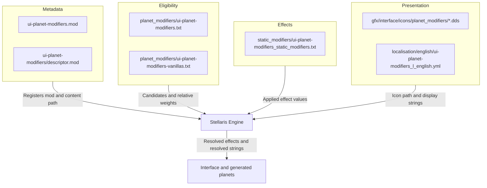
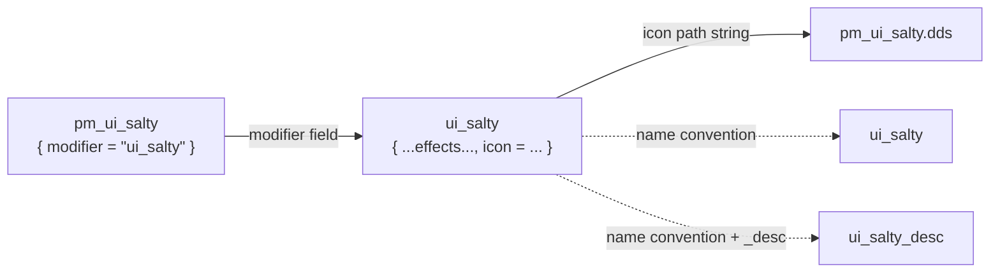

# Architecture

This document complements the root [ARCHITECTURE.md](../ARCHITECTURE.md). It records the architectural model as reconstructed from the definition files themselves and the reasoning behind each boundary, without duplicating the root document.

## Architectural classification

The repository is a **declarative host extension** with no executable surface. It contributes data to a closed host, the Stellaris engine, which owns parsing, evaluation, rendering, and persistence. The architectural consequences are severe and worth stating plainly:

| Property | Consequence |
|----------|-------------|
| No executable code | No unit of behaviour can be exercised, mocked, or tested in the repository |
| No dependency graph between repository files | Cross-file consistency is a convention, not a compiler-enforced dependency |
| Host-owned evaluation | All semantics of `add`, `factor`, and `factor = 0` are defined by the engine, not the repository |
| Host-owned identity | Vanilla identifiers referenced by the definitions may change without any repository change |
| Host-owned persistence | Removing or renaming a modifier leaves stale identifiers in existing saves |

## Layering

The definition set is layered by engine subsystem, not by abstraction:

Each layer is owned by a distinct engine subsystem. A defect in one layer produces a distinguishable symptom, which is why the failure taxonomy in [error-handling.md](./error-handling.md) is organised the same way.

## The two definition tiers

Planet modifiers are expressed through **two cooperating tiers** that must be kept in agreement:

1. **Eligibility tier** — `spawn_chance` blocks decide whether the modifier can be selected for a generated planet and with what relative weight.
2. **Effect tier** — static modifier blocks decide what the modifier does once selected and which icon represents it.

The binding between the tiers is a bare string: the eligibility tier's `modifier` field must equal an effect-tier key. Nothing validates the binding. A mismatch yields a modifier that can be selected but has no effect, or an effect block that is never reachable.

Presentation forms a third, looser tier: localisation keys are named after effect-tier keys rather than being referenced by any field, so the engine resolves them by name convention alone.

Solid edges are explicit field references. Dotted edges are name conventions resolved by the engine. Only the solid edges are visible in the definition text; the dotted edges are implicit and therefore the most fragile part of the architecture.

## Symmetry and asymmetry between the two definition files

The two files under `common/planet_modifiers/` are not parallel halves of one construct. They differ in purpose and in what they are allowed to reference:

| Aspect | `ui-planet-modifiers.txt` | `ui-planet-modifiers-vanillas.txt` |
|--------|---------------------------|-------------------------------------|
| Purpose | Introduce new modifiers | Replace a few host definitions so their spawn conditions exclude the new modifiers |
| Keys | Seven brand-new `pm_ui_*` keys | Two vanilla keys: `pm_weak_magnetic_field`, `pm_strong_magnetic_field` |
| `modifier` target | Newly defined `ui_*` effect keys | The matching vanilla effect keys |
| Effect tier owned here | Yes, in the sibling static modifier file | No, effects belong to the host |
| Exclusions | Exclude the new modifiers and relevant vanilla modifiers | Exclude the new modifier that overlaps the same theme |

The override file therefore exists for one reason: mutual exclusivity. A mod cannot append a condition to a definition the host owns, so the only way to stop a vanilla modifier from coexisting with a thematically identical new one is to re-declare the vanilla key with the extra exclusion. Because mod files load after the host's `00_planet_modifiers.txt`, an identical key replaces the vanilla definition rather than adding a second candidate.

## Selection semantics

The engine's selection model, as expressed by the definitions:

- `value`, where present, establishes a base weight. Vanilla `pm_null` uses it (`base = 275`); no definition in this repository declares a base weight.
- `add` entries contribute weight when their condition set is satisfied. Multiple `add` entries can all apply to the same candidate.
- `factor` entries multiply the accumulated weight. Multiple honoured factors compound multiplicatively.
- `factor = 0` **removes** the candidate regardless of any accumulated weight. It is the only exclusion mechanism; there is no separate `allowed` or `forbidden` clause.
- Absence of `value` means the base weight is zero, so a definition contributes weight only through its `add` entries.

The design implication is that exclusion and weight are the same machinery viewed two ways: `factor = 0` is multiplication by zero. That single mechanism carries every mutual-exclusion guarantee in the repository, which makes its omission the highest-consequence mistake a contributor can make. See [flows/planet-modifier-selection.md](./flows/planet-modifier-selection.md) and [invariants.md](./invariants.md).

## Ordering and evaluation model

Definitions do not observe one another. Within a single planet's evaluation, the engine evaluates each candidate independently — a `has_planet_modifier` condition inspects the planet's already-assigned modifier set, which is why the new modifiers can exclude each other and why the override file's conditions can reference both the vanilla original and the new counterpart.

Two consequences follow:

- **Order independence.** The override file and the additions file may be loaded in either order; because they declare distinct keys, neither shadows the other.
- **Sequential accumulation.** Because conditions can query an already-assigned modifier, outcomes depend on the assignment order the engine chooses. The repository neither controls nor documents that order, so exclusions are written to be symmetric where possible (each side excludes the other) to remove the dependency.

## Boundary semantics at the host interface

Each boundary has its own failure mode. Recording them together establishes the blast radius of a mistake.

| Boundary | Contract expressed in the repository | Failure mode if the contract breaks |
|----------|--------------------------------------|-------------------------------------|
| Launcher descriptor | `name`, `path`, `tags`, `supported_version` in both descriptors | Mod unlisted, path unresolvable, or flagged incompatible |
| Spawn parser | Clausewitz `spawn_chance` blocks with `add`, `factor`, `has_planet_modifier`, `is_planet_class`, `is_star_class`, `num_modifiers`, `solar_system`, `is_moon` | Definition discarded or logged; modifier never spawns |
| Effect parser | Effect keys with numeric values, `icon`, `icon_frame`, `important` | Effect not applied or block rejected |
| Icon loader | DDS texture whose path matches the definition literally | Missing or placeholder icon; modifier remains active |
| Localisation resolver | `l_english` keys matching the effect key and `_desc` variant | Raw key displayed instead of a name |
| Vanilla identifier space | `pc_*`, `sc_*`, and `pm_*` identifiers owned by the host | Condition becomes unevaluable after a host-side rename |

## Architectural invariants

The invariants that must hold for the architecture to remain coherent are enumerated with their evidence and verification method in [invariants.md](./invariants.md). The three most consequential are:

1. A definition's `modifier` field equals an existing effect-tier key.
2. Every effect-tier `icon` path resolves to an existing file, and every icon file is referenced.
3. Mutually exclusive modifier pairs exclude each other in both directions.

## Extension model

The repository has exactly one extension point: adding a planet modifier, which requires coordinated edits across four files plus an asset. The procedure and the conventions it must preserve are in [change-guide.md](./change-guide.md).

Extending an existing host-owned modifier follows the same pattern as the override file: declare a `pm_ui_*` spawn chance whose `modifier` field names the host's effect key, and include the host's identifier in exclusion conditions where it was previously absent.

## Related documentation

- [ARCHITECTURE.md](../ARCHITECTURE.md) for the root-level architectural description
- [data-model.md](./data-model.md) for the entity relationships
- [flows/](./flows/planet-modifier-selection.md) for the execution processes
- [design-decisions.md](./design-decisions.md) for the rationale behind the shape of the definition set
