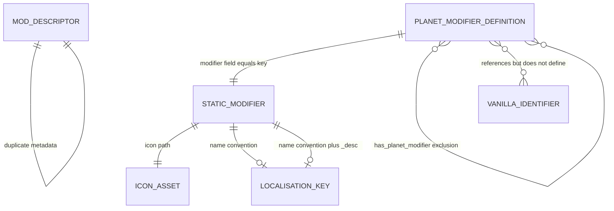

# Data model

The repository models planet modifiers as four cooperating record types joined by name. There are no database tables, no schemas, and no typed entities: the model exists only as Clausewitz syntax and YAML keys.

## Entity overview

## Record type: mod descriptor

| Field | Type | Value in this repository | Notes |
|-------|------|--------------------------|-------|
| `name` | String | `Universum Infinitum - Planet Modifiers` | Identical in both descriptors |
| `path` | String | `mod/ui-planet-modifiers` | Identical in both descriptors; names the content directory |
| `tags` | Block | `{ "Galaxy Generation" }` | Single tag; identical in both descriptors |
| `supported_version` | String | `2.6.*` | Identical in both descriptors |

Two descriptors exist with identical content: `ui-planet-modifiers.mod` at the repository root and `ui-planet-modifiers/descriptor.mod` inside the content directory. The root descriptor is the one the launcher consumes from the user mod directory; the copy inside the content directory is the form used by distribution archives.

## Record type: planet modifier definition

A definition is a top-level key of the form `pm_<name>` whose body contains one `spawn_chance` block and one `modifier` string.

| Element | Type | Required | Meaning |
|---------|------|----------|---------|
| Key | Identifier | Yes | The modifier's internal identity, e.g. `pm_ui_salty` |
| `spawn_chance.value` | Number | No | Base weight before `add` and `factor` are applied |
| `spawn_chance.modifier` | Block | Yes (repeatable) | One condition-plus-weight clause |
| `spawn_chance.modifier.add` | Number | No | Weight contributed when the block's conditions hold |
| `spawn_chance.modifier.factor` | Number | No | Weight multiplier applied when the block's conditions hold; `0` excludes |
| `modifier` | String | Yes | The effect-tier key this definition binds to |
| `is_null` | Flag | No | Marks a slot-occupying placeholder; only `pm_null` uses it |

### Condition vocabulary observed in this repository

| Condition | Scope | Example |
|-----------|-------|---------|
| `is_planet_class` | Planet | `is_planet_class = "pc_barren"` |
| `is_star_class` | Star system | `is_star_class = sc_black_hole` |
| `has_planet_modifier` | Planet | `has_planet_modifier = "pm_low_gravity"` |
| `num_modifiers` | Planet | `num_modifiers > 1` |
| `planet_size` | Planet | `planet_size > 19` |
| `is_moon` | Planet | `is_moon = yes` |
| `solar_system` | System scope wrapper | Wraps `OR` over `is_star_class` |
| `OR` | Logical combinator | Groups alternatives inside a clause |

Note that both quoted and unquoted identifier forms appear (`is_planet_class = "pc_barren"` and `is_planet_class = pc_barren`), and that `pc_barren` is written unquoted inside `OR` blocks in the override file. The engine accepts both, but the inconsistency is an incidental variation rather than a convention.

## Record type: static modifier

A static modifier is a top-level key of the form `ui_<name>` whose body contains effect keys and presentation fields.

| Element | Type | Required | Meaning |
|---------|------|----------|---------|
| Key | Identifier | Yes | The effect-tier identity, e.g. `ui_salty` |
| Effect key | Numeric | No | A named planetary effect and its value |
| `icon` | Path | Yes | Repository-relative DDS path, e.g. `gfx/interface/icons/planet_modifiers/pm_ui_salty.dds` |
| `icon_frame` | Integer | Yes | Frame index within the icon atlas presentation |
| `important` | Flag | No | Marks the modifier for prominent presentation |

### Effect keys used

| Effect key | Direction | Modifiers using it |
|-----------|-----------|--------------------|
| `pop_environment_tolerance` | Negative | `ui_twilight`, `ui_extreme_temperatures`, `ui_no_magnetic_field`, `ui_salty`, `ui_swampy`, `ui_giant_earthworms`, `ui_sea_monsters` |
| `pop_happiness` | Negative | `ui_twilight`, `ui_extreme_temperatures`, `ui_giant_earthworms`, `ui_sea_monsters` |
| `pop_growth_speed` | Negative | `ui_no_magnetic_field` |
| `planet_jobs_food_produces_mult` | Negative | `ui_salty`, `ui_swampy` |
| `planet_jobs_society_research_produces_mult` | Positive | `ui_giant_earthworms`, `ui_sea_monsters` |

### Icon frames in use

| `icon_frame` | Modifiers | Count |
|--------------|-----------|-------|
| `1` | `ui_microorganisms` | 1 |
| `2` | `ui_giant_earthworms`, `ui_sea_monsters` | 2 |
| `3` | `ui_twilight`, `ui_extreme_temperatures`, `ui_no_magnetic_field`, `ui_salty`, `ui_swampy` | 5 |

## Record type: localisation key

A localisation entry is a YAML mapping member inside the `l_english` document.

| Element | Format | Meaning |
|---------|--------|---------|
| Name key | `ui_<name>:0 "Display Name"` | The modifier's display name |
| Description key | `ui_<name>_desc:0 "Description text"` | The modifier's description |

Keys are resolved by name convention from the effect-tier key; no field references them. The `:0` suffix is the localisation version marker.

## Record type: icon asset

| Property | Value |
|----------|-------|
| Location | `ui-planet-modifiers/gfx/interface/icons/planet_modifiers/` |
| Naming | `pm_ui_<name>.dds` |
| Format | Microsoft DirectDraw Surface, 32-bit ARGB8888 |
| Dimensions | 60 x 60 |
| Count | Eight, one per new modifier |

## Full inventory of new modifiers

| Definition key | Effect key | Icon file | `icon_frame` | `important` | Accumulation guard |
|----------------|-----------|-----------|--------------|-------------|--------------------|
| `pm_ui_twilight` | `ui_twilight` | `pm_ui_twilight.dds` | 3 | No | `num_modifiers > 1` |
| `pm_ui_extreme_temperatures` | `ui_extreme_temperatures` | `pm_ui_extreme_temperatures.dds` | 3 | No | `num_modifiers > 1` |
| `pm_ui_no_magnetic_field` | `ui_no_magnetic_field` | `pm_ui_no_magnetic_field.dds` | 3 | No | `num_modifiers > 1` |
| `pm_ui_salty` | `ui_salty` | `pm_ui_salty.dds` | 3 | No | `num_modifiers > 1` |
| `pm_ui_swampy` | `ui_swampy` | `pm_ui_swampy.dds` | 3 | No | None |
| `pm_ui_microorganisms` | `ui_microorganisms` | `pm_ui_microorganisms.dds` | 1 | Yes | `num_modifiers > 2` |
| `pm_ui_giant_earthworms` | `ui_giant_earthworms` | `pm_ui_giant_earthworms.dds` | 2 | No | `num_modifiers > 1` |
| `pm_ui_sea_monsters` | `ui_sea_monsters` | `pm_ui_sea_monsters.dds` | 2 | No | `num_modifiers > 1` |

All eight definition keys, effect keys, and icon file stems agree.

## Full inventory of spawn-chance redefinitions

| Definition key | Bound effect key | Ownership of the effect | Accumulation guard |
|----------------|------------------|-------------------------|--------------------|
| `pm_null` | none (`is_null = yes`) | n/a | none; `value = 275` with three escalating `factor = 3` clauses |
| `pm_ui_hazardous_weather` | `hazardous_weather` | Host | `num_modifiers > 1` |
| `pm_ui_weak_magnetic_field` | `weak_magnetic_field` | Host | `num_modifiers > 1` |
| `pm_ui_strong_magnetic_field` | `strong_magnetic_field` | Host | `num_modifiers > 1` |
| `pm_ui_unstable_tectonics` | `unstable_tectonics` | Host | `num_modifiers > 1` |
| `pm_ui_tidal_locked` | `tidal_locked` | Host | `num_modifiers > 1` |
| `pm_ui_asteroid_impacts` | `asteroid_impacts` | Host | `num_modifiers > 1` |
| `pm_ui_wild_storms` | `wild_storms` | Host | `num_modifiers > 1` |
| `pm_ui_low_gravity` | `low_gravity` | Host | `num_modifiers > 1` |
| `pm_ui_high_gravity` | `high_gravity` | Host | `num_modifiers > 1` |

Nine of the ten redefinitions introduce a new key that binds to a host-owned effect; only `pm_null` redefines a host key of the same name.

## Referenced but undefined identifiers

These identifiers appear in conditions but are defined neither in this repository nor by the eight new modifiers. They belong to the host or to other mods.

| Category | Identifiers |
|----------|-------------|
| Planet modifiers | `pm_bleak`, `pm_lush`, `pm_tidal_locked`, `pm_low_gravity`, `pm_high_gravity`, `pm_titanic_life`, `pm_weak_magnetic_field`, `pm_strong_magnetic_field`, `pm_hazardous_weather`, `pm_asteroid_impacts`, `pm_wild_storms`, `pm_unstable_tectonics` |
| Planet classes | `pc_arctic`, `pc_tundra`, `pc_alpine`, `pc_desert`, `pc_frozen`, `pc_barren`, `pc_barren_cold`, `pc_arid`, `pc_nuked`, `pc_ocean`, `pc_continental`, `pc_tropical`, `pc_savannah` |
| Star classes | `sc_black_hole`, `sc_neutron_star`, `sc_pulsar` |

## Related documentation

- [components/](./components/planet-modifier-definitions.md) for per-component detail
- [invariants.md](./invariants.md) for the constraints these records must satisfy
- [configuration.md](./configuration.md) for how each record type alters behaviour
