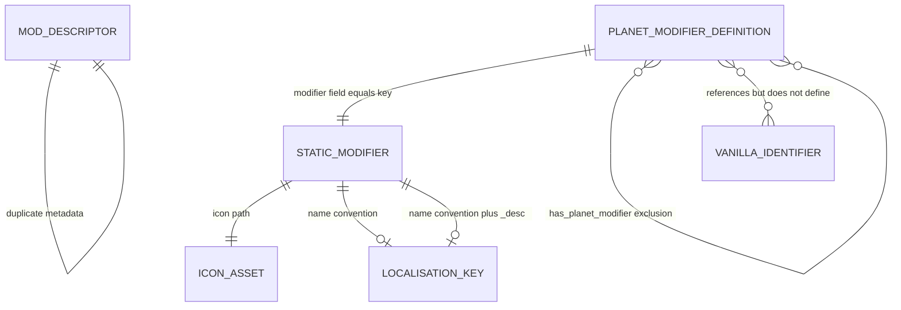

# Data model

The repository models planet modifiers as four cooperating record types joined by name. There are no database tables, no schemas, and no typed entities: the model exists only as Clausewitz syntax and YAML keys.

## Entity overview

## Record type: mod descriptor

| Field | Type | Value in this repository | Notes |
|-------|------|--------------------------|-------|
| `name` | String | `Universum Infinitum - Planet Modifiers` | Identical in both descriptors |
| `path` | String | `mod/ui-planet-modifiers` | Identical in both descriptors; names the content directory |
| `tags` | Block | `{ "Galaxy Generation" }` | Single tag; identical in both descriptors |
| `supported_version` | String | `v4.5.*` | Identical in both descriptors |

Two descriptors exist with identical content: `ui-planet-modifiers.mod` at the repository root and `ui-planet-modifiers/descriptor.mod` inside the content directory. The root descriptor is the one the launcher consumes from the user mod directory; the copy inside the content directory is the form used by distribution archives.

## Record type: planet modifier definition

A definition is a top-level key of the form `pm_<name>` whose body contains one `spawn_chance` block and one `modifier` string. Keys in the override file are vanilla keys, so re-declaring them replaces the host definition.

| Element | Type | Required | Meaning |
|---------|------|----------|---------|
| Key | Identifier | Yes | The modifier's internal identity, e.g. `pm_ui_salty` |
| `spawn_chance.base` | Number | No | Base weight before `add` and `factor` are applied; used only by vanilla `pm_null` |
| `spawn_chance.modifier` | Block | Yes (repeatable) | One condition-plus-weight clause |
| `spawn_chance.modifier.add` | Number | No | Weight contributed when the block's conditions hold |
| `spawn_chance.modifier.factor` | Number | No | Weight multiplier applied when the block's conditions hold; `0` excludes |
| `modifier` | String | Yes | The effect-tier key this definition binds to |
| `is_null` | Flag | No | Marks a slot-occupying placeholder; only vanilla `pm_null` uses it, and the mod does not declare it |

### Condition vocabulary observed in this repository

| Condition | Scope | Example |
|-----------|-------|---------|
| `is_planet_class` | Planet | `is_planet_class = "pc_barren"` |
| `is_star_class` | Star system | `is_star_class = sc_black_hole` |
| `has_planet_modifier` | Planet | `has_planet_modifier = "pm_low_gravity"` |
| `num_modifiers` | Planet | `num_modifiers > 1` |
| `planet_size` | Planet | `planet_size > 19` |
| `is_moon` | Planet | `is_moon = yes` |
| `solar_system` | System scope wrapper | Wraps `OR` over `is_star_class` |
| `OR` | Logical combinator | Groups alternatives inside a clause |

`planet_size` and `is_moon` appear only in the re-declared vanilla blocks, which reproduce the vanilla conditions verbatim; the additions file does not use either.

Every identifier is quoted in both files, including inside `OR` blocks.

## Record type: static modifier

A static modifier is a top-level key of the form `ui_<name>` whose body contains effect keys and presentation fields.

| Element | Type | Required | Meaning |
|---------|------|----------|---------|
| Key | Identifier | Yes | The effect-tier identity, e.g. `ui_salty` |
| Effect key | Numeric | No | A named planetary effect and its value |
| `icon` | Path | Yes | Repository-relative DDS path, e.g. `gfx/interface/icons/planet_modifiers/pm_ui_salty.dds` |
| `icon_frame` | Integer | Yes | Frame index within the icon atlas presentation |
| `important` | Flag | No | Marks the modifier for prominent presentation |

### Effect keys used

| Effect key | Direction | Modifiers using it |
|-----------|-----------|--------------------|
| `pop_environment_tolerance` | Negative | All five blocks |
| `pop_happiness` | Negative | `ui_extreme_temperatures`, `ui_thin_atmosphere` |
| `logistic_growth_mult` | Negative | `ui_no_magnetic_field` |
| `planet_jobs_food_produces_mult` | Negative | `ui_extreme_temperatures`, `ui_salty`, `ui_swampy` |
| `planet_jobs_energy_produces_mult` | Negative | `ui_thin_atmosphere` |
| `planet_jobs_physics_research_produces_mult` | Negative | `ui_no_magnetic_field` |
| `district_farming_max_add` | Negative | `ui_salty` |
| `planet_structures_cost_mult` | Positive | `ui_swampy` |

### Icon frames in use

| `icon_frame` | Modifiers | Count |
|--------------|-----------|-------|
| `3` | `ui_extreme_temperatures`, `ui_no_magnetic_field`, `ui_salty`, `ui_swampy`, `ui_thin_atmosphere` | 5 |

Every block uses frame 3, the vanilla convention for a net penalty.

## Record type: localisation key

A localisation entry is a YAML mapping member inside the `l_english` document.

| Element | Format | Meaning |
|---------|--------|---------|
| Name key | `ui_<name>:0 "Display Name"` | The modifier's display name |
| Description key | `ui_<name>_desc:0 "Description text"` | The modifier's description |

Keys are resolved by name convention from the effect-tier key; no field references them. The `:0` suffix is the localisation version marker.

## Record type: icon asset

| Property | Value |
|----------|-------|
| Location | `ui-planet-modifiers/gfx/interface/icons/planet_modifiers/` |
| Naming | `pm_ui_<name>.dds` |
| Format | Microsoft DirectDraw Surface, 32-bit ARGB8888 |
| Dimensions | 60 x 60 |
| Count | Five, one per new modifier |

## Full inventory of new modifiers

| Definition key | Effect key | Icon file | `icon_frame` | `important` | Accumulation guard |
|----------------|-----------|-----------|--------------|-------------|--------------------|
| `pm_ui_extreme_temperatures` | `ui_extreme_temperatures` | `pm_ui_extreme_temperatures.dds` | 3 | No | `num_modifiers > 1` |
| `pm_ui_no_magnetic_field` | `ui_no_magnetic_field` | `pm_ui_no_magnetic_field.dds` | 3 | No | `num_modifiers > 1` |
| `pm_ui_salty` | `ui_salty` | `pm_ui_salty.dds` | 3 | No | `num_modifiers > 1` |
| `pm_ui_swampy` | `ui_swampy` | `pm_ui_swampy.dds` | 3 | No | `num_modifiers > 1` |
| `pm_ui_thin_atmosphere` | `ui_thin_atmosphere` | `pm_ui_thin_atmosphere.dds` | 3 | No | `num_modifiers > 1` |

All five definition keys, effect keys, and icon file stems agree.

## Full inventory of spawn-chance redefinitions

| Definition key | Bound effect key | Ownership of the effect | Change relative to vanilla v4.5 |
|----------------|------------------|-------------------------|----------------------------------|
| `pm_weak_magnetic_field` | `weak_magnetic_field` | Host | Adds an exclusion for `pm_ui_no_magnetic_field` |
| `pm_strong_magnetic_field` | `strong_magnetic_field` | Host | Adds an exclusion for `pm_ui_no_magnetic_field` |

Each re-declaration reproduces the vanilla v4.5 conditions for the same key, including weights, size multipliers, the Gaia exclusion, and the accumulation guard. Only the added exclusion differs. Because the keys are the vanilla keys, the mod's definitions replace the host's rather than coexisting with them.

## Records the mod does not own

Vanilla `pm_null` is neither re-declared nor referenced. `hazardous_weather`, `unstable_tectonics`, `asteroid_impacts`, `wild_storms`, `tidal_locked`, `low_gravity`, and `high_gravity` are not re-declared; the mod only reads `pm_low_gravity`, `pm_high_gravity`, `pm_bleak`, and `pm_tidal_locked` as weighting and exclusion signals.
