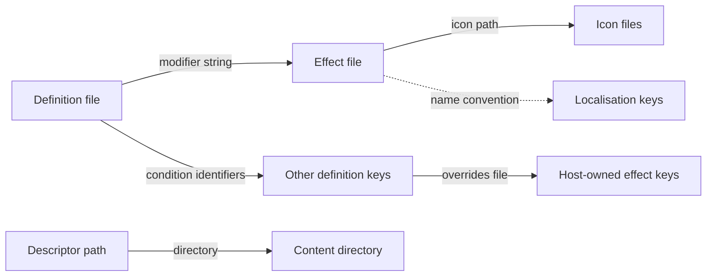

# Dependencies

## External dependencies

| Dependency | Type | Responsibility | Boundary | Consequence |
|------------|------|----------------|----------|-------------|
| Stellaris engine | Runtime host | Parses definitions, evaluates spawn chances, applies effects, renders icons, persists state | Mod loader and definition parsers | The mod cannot run, be tested, or be verified without the host |
| Vanilla planet modifier identifiers | Host data | Supplies identifiers referenced by conditions: `pm_bleak`, `pm_tidal_locked`, `pm_low_gravity`, `pm_weak_magnetic_field`, `pm_strong_magnetic_field` | `has_planet_modifier` conditions | A host-side rename changes or disables eligibility logic silently |
| Vanilla planet classes | Host data | 13 classes used as spawn conditions, from `pc_arctic` to `pc_savannah` | `is_planet_class` conditions | An introduced class is never covered until conditions are revised |
| Vanilla static modifiers | Host data | Two effect keys bound by the override file: `weak_magnetic_field` and `strong_magnetic_field` | Definition `modifier` fields | If one is renamed, the corresponding definition resolves to no effect |
| Steam Workshop platform | Distribution | Publishes the mod to players | `.github/workflows/steam-workshop-release.yml` | Availability depends on the platform, not the repository |
| GitHub Releases | Distribution | Publishes a release archive | `.github/workflows/github-release.yml` | The archive is built from the tagged revision, so it matches the release tag rather than the working tree |
| GIMP | Development tooling only | Produces the DDS icons from `src/planet_modifier.xcf` | Icon asset pipeline | Not required to use or review the mod, only to produce new artwork |
| Image editor with DDS support | Development tooling only | Writing DDS output | Icon asset pipeline | A malformed export may render incorrectly with no repository-visible signal |

## Internal dependencies

The repository has no compile-time, link-time, or run-time dependency graph between its own files. What exists is a set of **name-based bindings** resolved by the host:

| Source | Target | Binding mechanism |
|--------|--------|-------------------|
| Definition `modifier` field | Static modifier key | Exact string equality |
| Definition exclusion conditions | Other definitions' keys | Exact string equality |
| Static modifier `icon` field | Icon file path | Literal path resolution |
| Static modifier key | Localisation keys | Name convention, plus `_desc` suffix |
| Descriptor `path` | Content directory | Literal path resolution |

Because the bindings are name-based, a tool such as a compiler or linker cannot detect a break. This is the single most important dependency property of the repository.

Dotted and solid edges are equally brittle; the distinction is only whether a field carries the reference explicitly.

## Absent dependencies

| Absent | Consequence |
|--------|-------------|
| Build tool | Nothing compiles; no build can fail |
| Package manager | No third-party code is vendored or restored |
| Test framework | No automated verification is possible |
| Linter or validator | Definition syntax is checked only by the host at load time |
| Continuous integration | No check runs on a change; `.github/workflows/github-release.yml` only packages the archive when a release is published, and `.github/workflows/steam-workshop-release.yml` only uploads to the Steam Workshop on tag pushes |
| Code generator | Icons and localisation are edited by hand |

The absence is not an oversight; a static-data mod legitimately requires none of these. The cost is that every cross-file invariant in [invariants.md](./invariants.md) relies on contributor discipline.

## Version exposure

| Exposure | Detail |
|----------|--------|
| Declared compatibility | `supported_version="v4.5.*"`, matching the current release line |
| Verification status | The declared version is not verified by any repository artefact |
| Host identifier exposure | Every `pc_*`, `sc_*`, and `pm_*` identifier referenced is outside the repository's control |
| Mitigation available | None within the repository; only in-game verification detects a regression |

## Related documentation

- [integrations.md](./integrations.md) for the integration surfaces
- [configuration.md](./configuration.md) for how the sources alter behaviour
- [testing.md](./testing.md) for the verification gaps these dependencies create
