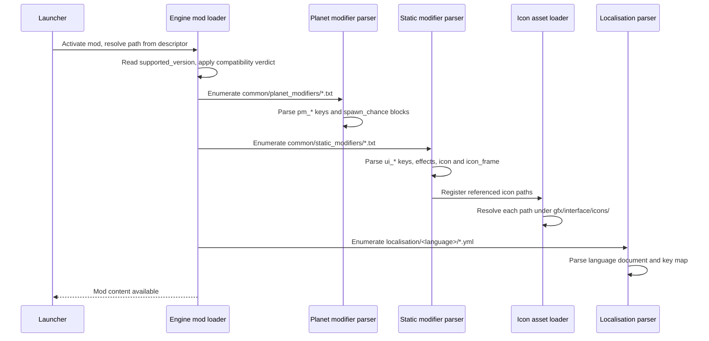

# Flow: game startup and loading

## Scope

From the launcher registering the mod to the engine having every definition, icon, and localisation key available for use. This flow explains *why* a change to one file can succeed or fail at load time rather than at selection time.

## Participants

| Participant | Role |
|-------------|------|
| Stellaris launcher | Reads descriptors, exposes the mod for activation, applies the version verdict |
| Stellaris engine mod loader | Resolves the content path and enumerates loadable definitions |
| Planet modifier parser | Parses `common/planet_modifiers/*.txt` |
| Static modifier parser | Parses `common/static_modifiers/*.txt` |
| Icon asset loader | Registers icon paths referenced by static modifiers |
| Localisation parser | Parses `localisation/<language>/*.yml` |

## Sequence

## Step by step

1. **Descriptor resolution.** The launcher reads `ui-planet-modifiers.mod` (or the archive's `descriptor.mod`) to obtain `name`, `path`, `tags`, and `supported_version`. The `path` value determines which directory is scanned; if it does not resolve, no content is loaded.
2. **Compatibility verdict.** `supported_version="v4.5.*"` is compared against the running game version. A mismatch is a launcher-level warning, not a load abort; the mod may still be loaded.
3. **Definition enumeration.** Both files under `common/planet_modifiers/` are parsed. Parsing is per-key, so a malformed block is discarded without necessarily discarding its siblings. Distinct keys merge into one candidate pool; a duplicate key in two files resolves to one winner.
4. **Effect enumeration.** `common/static_modifiers/ui-planet-modifiers_static_modifiers.txt` is parsed into the effect registry keyed by `ui_*` identifiers. The `modifier` strings in the definition file are not resolved at this point; the binding is by shared key space.
5. **Icon registration.** Each effect block's `icon` string is registered as a path. Paths are resolved against the mod content directory, so the value must omit the `ui-planet-modifiers/` prefix.
6. **Localisation parsing.** The YAML document root (`l_english`) selects the target locale; entries populate the key map. Failure to parse an entire file removes every key it defines, because the file is the parse unit.
7. **Hand-off.** Nothing further happens until planet generation. No code in the repository runs; the engine now holds the complete definition set in memory.

## Why load order does not matter here

The two definition files declare disjoint key sets except where the override file intentionally restates a host key (`pm_null`). Because the engine merges by key rather than by sequential application, no ordering dependency exists between them. This is the reason [invariants.md](../invariants.md) can assert order independence.

## Failure points and their phase

| Failure | Phase | Observable symptom |
|---------|-------|--------------------|
| `path` unresolvable | 1 | Mod listed with no content, or absent |
| Version mismatch | 2 | Launcher compatibility warning |
| Malformed `spawn_chance` | 3 | Definition discarded; modifier never spawns |
| Duplicate key across files | 3 | One definition wins; the other is unobservable |
| Malformed effect block | 4 | Effect not applied |
| Icon path wrong | 5 | Missing or placeholder icon; modifier remains active |
| Localisation file unparseable | 6 | All 16 keys display as raw identifiers |
| Missing individual key | 6 | That one key displays raw |

Load-time failures are silent within the repository. The only repository-adjacent evidence is the engine log described in [logging.md](../logging.md).

## Related documentation

- [flows/planet-modifier-selection.md](./planet-modifier-selection.md) for what happens after loading
- [error-handling.md](../error-handling.md) for the failure taxonomy
- [build-and-deployment.md](../build-and-deployment.md) for how the content directory is delivered
