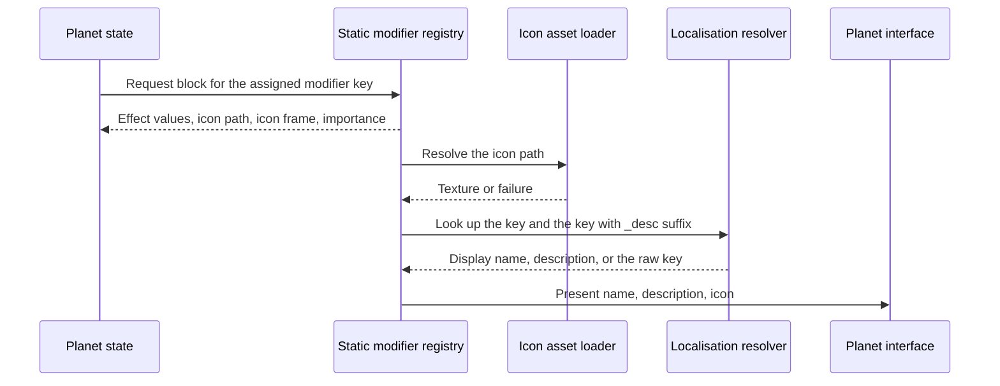

# Flow: modifier presentation

## Scope

From a modifier being recorded on a planet to the player seeing its name, description, and icon. This flow explains why a missing localisation key or a wrong icon path is a distinct, separately diagnosable defect.

## Participants

| Participant | Role |
|-------------|------|
| Static modifier registry | Provides the effect block, `icon`, `icon_frame`, and `important` for the assigned key |
| Icon asset loader | Resolves the DDS path against the mod content directory |
| Localisation resolver | Looks up the name key and the `_desc` key by convention |
| Planet interface | Renders the modifier in the planet view |

## Sequence

## Step by step

1. **Block resolution.** The assigned definition's `modifier` string is looked up in the effect registry. A miss here is the most consequential presentation failure, because no effect, icon, or importance flag is available.
2. **Icon resolution.** The block's `icon` value is resolved relative to the mod content directory. Success yields a texture; failure yields a missing or placeholder icon while the modifier remains otherwise functional.
3. **Frame selection.** `icon_frame` selects the frame within the icon presentation slot. All eight new modifiers use frame 1, 2, or 3.
4. **Name resolution.** The block's key is looked up directly. `ui_salty` resolves to the string *Salty*.
5. **Description resolution.** The key with `_desc` appended is looked up. `ui_salty_desc` resolves to the salinity description.
6. **Emphasis.** A block carrying `important = yes` is presented in the prominent form. Only `ui_microorganisms` sets it.
7. **Rendering.** The planet interface composes the icon, name, and description.

## Degradation ladder

Presentation failures are independent and each degrades a different facet. The ordering below reflects severity.

| Defect | Name shown | Description shown | Icon shown | Effect applied |
|--------|-----------|-------------------|-----------|----------------|
| None | Correct | Correct | Correct | Yes |
| Description key missing | Correct | Raw key | Correct | Yes |
| Name key missing | Raw key | Raw key or nothing | Correct | Yes |
| Locale file unparseable | Raw keys | Raw keys | Correct | Yes |
| Icon path wrong | Correct | Correct | Missing or placeholder | Yes |
| `icon_frame` wrong | Correct | Correct | Wrong frame | Yes |
| Effect block missing | Raw key | Raw key | Missing | No effect |
| `modifier` field misspelled | Raw key | Raw key | Missing | No effect |

The last two rows are the reason a binding error is worse than a cosmetic error: the definition remains selectable, so the modifier appears in the pool, occupies a modifier slot, and confers nothing.

## Emphasis and slot cost

`pm_null` exists to occupy a slot with no effect. `ui_microorganisms` occupies a slot and sets `important = yes` with no effect keys. Both therefore consume planetary modifier capacity without changing statistics, which is a deliberate presentation and pacing choice rather than a defect; the relaxed accumulation guard on `pm_ui_microorganisms` (`num_modifiers > 2` instead of `> 1`) is consistent with that reading.

## Related documentation

- [components/localisation.md](../components/localisation.md) for key resolution
- [components/icon-assets.md](../components/icon-assets.md) for texture requirements
- [error-handling.md](../error-handling.md) for the failure taxonomy
- [troubleshooting.md](../troubleshooting.md) for diagnostic procedures
