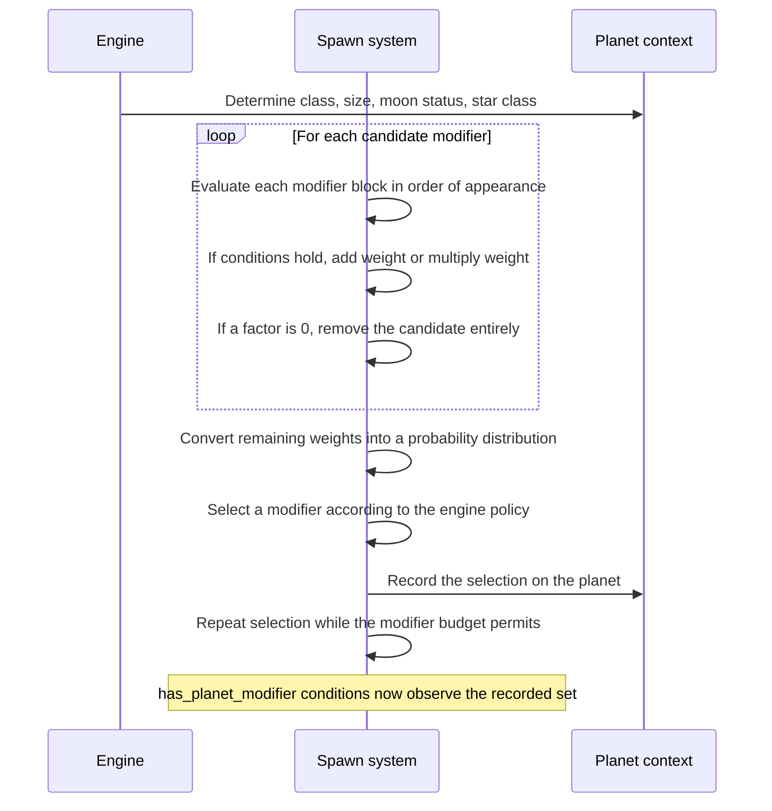

# Flow: planet modifier selection

## Scope

From the engine generating a planet to the assignment of a set of planet modifiers. This is the flow in which every weight, multiplier, and exclusion in the repository has its effect.

## Preconditions

- The mod is active and its content loaded, as described in [game-startup-and-loading.md](./game-startup-and-loading.md).
- A planet is being generated or re-evaluated, so its class, size, moon status, and solar system are known.
- The candidate pool consists of every definition the engine can resolve, combining vanilla definitions, this mod's eight new definitions, and this mod's ten redefinitions.

## Sequence

## Step by step

1. **Context assembly.** The engine determines the properties its conditions can test: planet class, planet size, whether the body is a moon, and the enclosing system's star class.
2. **Per-candidate evaluation.** For each candidate definition, its `spawn_chance` blocks are evaluated in file order.
3. **Base weight.** A `value` clause establishes the base weight. Only `pm_null` declares one (`value = 275`); every other definition starts from zero.
4. **Additive accumulation.** Every `add` clause whose conditions hold contributes its value. Several `add` clauses can apply to the same candidate, as in `pm_ui_salty`, whose barren, cold-barren, and arid-class clauses each add independently to the same candidate only when their class conditions overlap — they do not, so at most one applies in practice.
5. **Multiplicative accumulation.** Every `factor` clause whose conditions hold multiplies the running weight. Multipliers compound: `pm_ui_low_gravity` on a size-6 barren planet applies ×2, ×2, and ×2 for a cumulative ×8.
6. **Exclusion.** Any satisfied `factor = 0` clause removes the candidate from the pool regardless of the weight reached. This is the sole exclusion mechanism.
7. **Normalisation and selection.** Remaining weights form a probability distribution over the surviving candidates; the engine samples from it according to its own policy.
8. **Recording.** The selected modifier is written onto the planet.
9. **Iteration.** Selection repeats while the engine's modifier budget allows, and each iteration re-evaluates `has_planet_modifier` against the set recorded so far.

## Why step 9 makes exclusions order-sensitive

`has_planet_modifier` conditions observe the planet's current assignment. Two consequences follow:

- An exclusion written on only one side of a pair will fire in some orders and not others. The repository avoids this for the modifiers it introduces by writing symmetric exclusions where a conflict exists — `pm_ui_twilight` and `pm_ui_extreme_temperatures` each exclude the other.
- The accumulation guards (`num_modifiers > 1` or `> 2`) are evaluated per iteration, so they effectively cap the number of modifiers a planet can carry when the mod's definitions are the ones being considered.

### Where order sensitivity remains

| Pair | Excluded by twilight | Excluded by extreme temperatures | Symmetric |
|------|----------------------|----------------------------------|-----------|
| `pm_ui_twilight` / `pm_ui_extreme_temperatures` | yes | yes | Yes |
| `pm_ui_no_magnetic_field` / `pm_ui_weak_magnetic_field` | n/a | n/a | Yes, through the shared five-identifier list |
| `pm_ui_no_magnetic_field` / `pm_ui_strong_magnetic_field` | n/a | n/a | Yes, through the shared five-identifier list |
| `pm_ui_giant_earthworms` / `pm_ui_sea_monsters` | n/a | n/a | Not directly; both exclude `pm_titanic_life` and themselves, but neither excludes the other |
| `pm_ui_unstable_tectonics` / `pm_ui_high_gravity` | n/a | n/a | No; tectonics excludes high gravity, high gravity does not exclude tectonics |

The last two rows mean that accumulation guards, rather than exclusions, are what prevent certain combinations. Because the guard is `num_modifiers > 1`, a planet carrying one modifier will exclude both candidates, so in practice the combinations are prevented by the budget rather than by a declared conflict.

## Weighting consequences

| Property | Consequence |
|----------|-------------|
| Weights are relative | Changing one weight shifts every other modifier's effective probability even though their own definitions are untouched |
| Multipliers compound | Two ×2 clauses produce ×4, not ×2 |
| Zero is absolute | A `factor = 0` cannot be undone by any later `add`, because `add` clauses are evaluated into a weight that the zero factor discards |
| Absence of `value` means zero base | A definition with no `add` clause satisfied contributes nothing and cannot be selected |

## Worked example: `pm_ui_low_gravity` on a size-6 barren planet in a habitable system

| Clause | Condition | Applied? | Running weight |
|--------|-----------|----------|----------------|
| `add = 10` | barren or cold barren | Yes | 10 |
| `factor = 2` | size below 14 | Yes | 20 |
| `factor = 2` | size below 12 | Yes | 40 |
| `factor = 2` | size below 7 | Yes | 80 |
| `factor = 0.5` | size above 19 | No | 80 |
| `factor = 0` | any gravity modifier present | No | 80 |
| `factor = 0` | `num_modifiers > 1` | No | 80 |

The candidate enters selection with weight 80, which is high relative to most vanilla candidates and makes low gravity on small barren worlds a frequent outcome.

## Worked example: `pm_ui_swampy` on a tropical planet already carrying one modifier

| Clause | Condition | Applied? | Running weight |
|--------|-----------|----------|----------------|
| `add = 3` | ocean class | No | 0 |
| `add = 6` | tropical class | Yes | 6 |
| *(no other clauses)* | — | — | 6 |

Because `pm_ui_swampy` declares no `factor = 0`, it survives despite the existing modifier and enters selection with weight 6. This is the only new modifier with that property.

## Related documentation

- [architecture.md](../architecture.md) for why exclusion and weighting share one mechanism
- [components/planet-modifier-definitions.md](../components/planet-modifier-definitions.md) for the per-modifier clauses
- [components/vanilla-spawn-overrides.md](../components/vanilla-spawn-overrides.md) for the redefinitions
- [concurrency-and-scheduling.md](../concurrency-and-scheduling.md) for determinism in multiplayer
