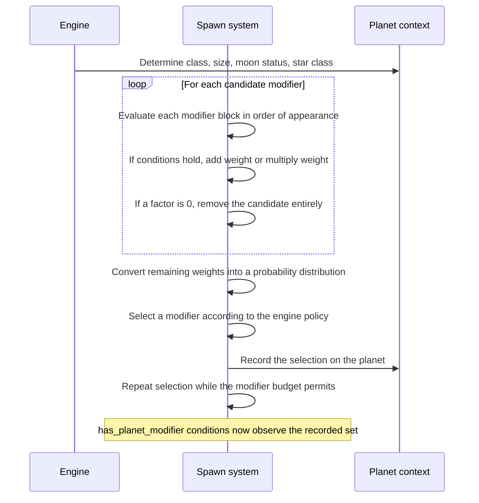

# Flow: planet modifier selection

## Scope

From the engine generating a planet to the assignment of a set of planet modifiers. This is the flow in which every weight, multiplier, and exclusion in the repository has its effect.

## Preconditions

- The mod is active and its content loaded, as described in [game-startup-and-loading.md](./game-startup-and-loading.md).
- A planet is being generated or re-evaluated, so its class, size, moon status, and solar system are known.
- The candidate pool consists of every definition the engine can resolve, combining vanilla definitions with this mod's five new definitions. The mod's two vanilla re-declarations replace their host counterparts rather than adding candidates.

## Sequence

## Step by step

1. **Context assembly.** The engine determines the properties its conditions can test: planet class, planet size, whether the body is a moon, and the enclosing system's star class.
2. **Per-candidate evaluation.** For each candidate definition, its `spawn_chance` blocks are evaluated in file order.
3. **Base weight.** Vanilla `pm_null` uses `base = 275`; no definition in this repository declares a base weight, so every mod candidate starts from zero.
4. **Additive accumulation.** Every `add` clause whose conditions hold contributes its value. `pm_ui_extreme_temperatures` is the clearest case: a barren world receives `add = 5` and a dry world receives `add = 10`, and a world that is both accumulates 15.
5. **Multiplicative accumulation.** Every `factor` clause whose conditions hold multiplies the running weight, so `pm_ui_extreme_temperatures` on a bleak desert reaches `10 × 2 = 20`.
6. **Exclusion.** Any satisfied `factor = 0` clause removes the candidate from the pool regardless of the weight reached. This is the sole exclusion mechanism.
7. **Normalisation and selection.** Remaining weights form a probability distribution over the surviving candidates; the engine samples from it according to its own policy.
8. **Recording.** The selected modifier is written onto the planet.
9. **Iteration.** Selection repeats while the engine's modifier budget allows, and each iteration re-evaluates `has_planet_modifier` against the set recorded so far.

## Why step 9 makes exclusions order-sensitive

`has_planet_modifier` conditions observe the planet's current assignment. Two consequences follow:

- An exclusion written on only one side of a pair will fire in some orders and not others. The repository writes symmetric exclusions where a conflict exists — `pm_ui_salty` and `pm_ui_swampy` each exclude the other.
- The accumulation guard (`num_modifiers > 1`) is evaluated per iteration, so it effectively caps the number of modifiers a planet can carry at one while any of the mod's definitions is being considered.

### Symmetry of the declared conflicts

| Pair | Clause on the first side | Clause on the second side | Symmetric |
|------|--------------------------|---------------------------|-----------|
| `pm_ui_salty` / `pm_ui_swampy` | excludes | excludes | Yes |
| `pm_ui_thin_atmosphere` / `pm_ui_extreme_temperatures` | excludes | excludes | Yes |
| `pm_ui_no_magnetic_field` / `pm_weak_magnetic_field` | excludes | excludes, via the re-declaration | Yes |
| `pm_ui_no_magnetic_field` / `pm_strong_magnetic_field` | excludes | excludes, via the re-declaration | Yes |
| `pm_ui_extreme_temperatures` / `pm_tidal_locked` | excludes | not declared; the vanilla key is not re-declared | No |
| `pm_ui_thin_atmosphere` / `pm_bleak` | excludes | not declared; the vanilla key is not re-declared | No |

The last two rows are the asymmetric pairs. It cannot produce a contradictory planet in practice, because the accumulation guard excludes the mod's modifier once a tidal lock occupies the slot; it is recorded here rather than hidden.

## Weighting consequences

| Property | Consequence |
|----------|-------------|
| Weights are relative | Changing one weight shifts every other modifier's effective probability even though their own definitions are untouched |
| Multipliers compound | Two ×2 clauses produce ×4, not ×2 |
| Zero is absolute | A `factor = 0` cannot be undone by any later `add`, because `add` clauses are evaluated into a weight that the zero factor discards |
| Absence of a base weight means zero | A definition with no `add` clause satisfied contributes nothing and cannot be selected |

## Worked example: `pm_ui_extreme_temperatures` on a bleak desert world

| Clause | Condition | Applied? | Running weight |
|--------|-----------|----------|----------------|
| `add = 10` | dry class among `pc_desert`, `pc_arid`, `pc_alpine`, `pc_nuked` | Yes | 10 |
| `add = 5` | barren or cold barren | No | 10 |
| `factor = 2` | planet carries `pm_bleak` | Yes | 20 |
| `factor = 0` | tidal lock present | No | 20 |
| `factor = 0` | `num_modifiers > 1` | No | 20 |

The candidate enters selection with weight 20, exactly twice the weight of a vanilla class-based candidate such as `pm_low_gravity`, which is a deliberate but modest advantage for a thematically fitting world.

## Worked example: `pm_ui_swampy` on a tropical planet already carrying one modifier

| Clause | Condition | Applied? | Running weight |
|--------|-----------|----------|----------------|
| `add = 10` | tropical class | Yes | 10 |
| `add = 5` | ocean class | No | 10 |
| `factor = 0` | salty or swampy already present | No | 10 |
| `factor = 0` | `num_modifiers > 1` | Yes | 0 |

The accumulation guard removes the candidate, so no new modifier can join a planet that already carries one.

## Related documentation

- [architecture.md](../architecture.md) for why exclusion and weighting share one mechanism
- [components/planet-modifier-definitions.md](../components/planet-modifier-definitions.md) for the per-modifier clauses
- [components/vanilla-spawn-overrides.md](../components/vanilla-spawn-overrides.md) for the redefinitions
- [concurrency-and-scheduling.md](../concurrency-and-scheduling.md) for determinism in multiplayer
