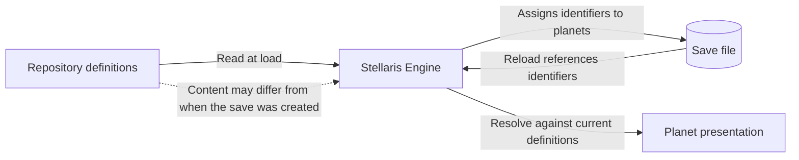

# State and persistence

## What state exists

The repository owns no state. Every persistent value in a game that uses the mod belongs to the Stellaris engine.

| State | Owner | Representation | Lifetime |
|-------|-------|----------------|----------|
| Assigned planet modifiers | Stellaris engine | Engine-internal planet data, serialised into the save file | From generation until the save is deleted |
| Mod activation | Stellaris engine | Playset configuration held outside the repository | Per profile; not stored in the repository |
| Mod metadata | Repository | Static descriptor text | Immutable per release |
| Definitions, effects, localisation | Repository | Static text files | Immutable per release |
| Icons | Repository | Static binary textures | Immutable per release |

## The save-file boundary

Assigned modifiers persist inside the save. A save therefore stores *identifiers* — `pm_ui_salty`, `ui_salty` — rather than any definition content.

Three consequences follow, and they are the reason this document exists:

1. **Removing the mod leaves stale identifiers.** A planet in an existing save still references `pm_ui_salty`. Without the mod, the engine cannot resolve the effect block or the localisation keys, so the modifier may render with a raw key and confer no effect.
2. **Renaming a key breaks existing saves.** If `pm_ui_salty` becomes `pm_ui_saline`, every planet that recorded the old identifier loses its effect and localisation, because saves store the identifier rather than a definition copy.
3. **Changing an effect retroactively alters existing saves.** Because the effect is resolved from the current definition at load time, raising `ui_salty`'s food penalty affects planets in saves created before the change.

## Repository state that is effectively immutable

| Artefact | Why it must remain stable |
|----------|--------------------------|
| Identifier namespace (`pm_*`, `ui_*` keys) | Saves and cross-file conditions reference these strings |
| Icon paths | Effect blocks reference them literally |
| Localisation keys | Resolved by convention from effect keys |
| Content directory name | The descriptor `path` names it |

Everything else — weights, multipliers, effect values, description text, artwork pixels — can change without breaking a save, since it is re-read at load time rather than recorded in the save.

## What is not state

- No cache, no index, no database, no log written by the repository.
- No configuration file that the mod reads at run time; all configuration is the definition content itself.
- No session state; the mod has no lifecycle beyond being loaded.

## Migration implications

There is no migration mechanism and none is possible, because the mod cannot transform saved data. The only safe renaming strategy is additive: introduce the new identifier, keep the old one resolvable, and accept that old saves retain the old identifier permanently.

When a modifier is removed, the practical effect on existing saves is a dangling reference. Contributors should treat identifier removal as a breaking change for saves, even though the repository contains no code to break.

## Related documentation

- [invariants.md](./invariants.md) for the identifier-stability constraints
- [change-guide.md](./change-guide.md) for the safe change procedures
- [build-and-deployment.md](./build-and-deployment.md) for how content reaches a player's installation
